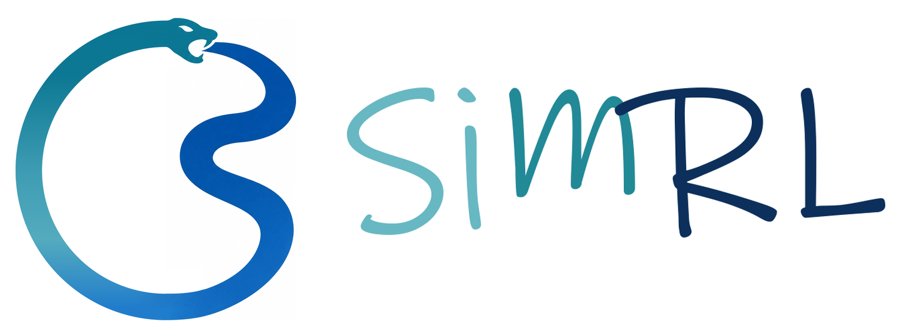
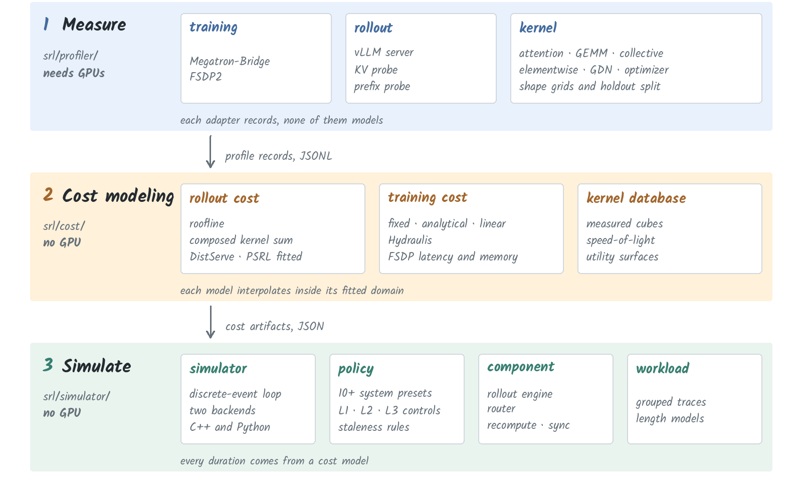
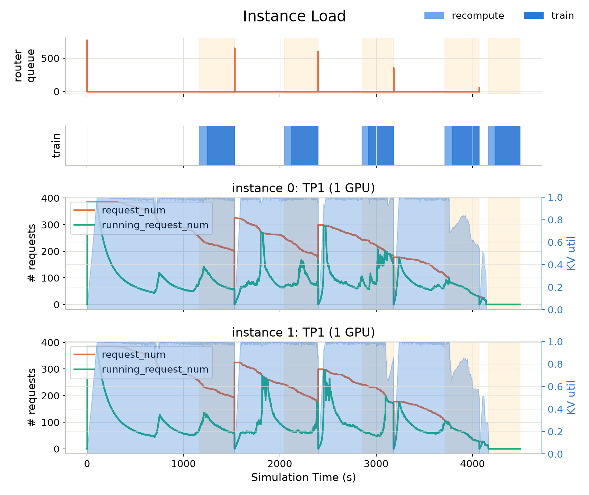

<p align="center">
  
</p>

<p align="center">
  <a href="https://simrl.readthedocs.io/en/latest/"></a>
  <a href="LICENSE"></a>
  <a href="https://github.com/psrl-project/SimRL"></a>
</p>

# SimRL

SimRL is a discrete-event simulator for asynchronous, disaggregated RL post-training of large language
models. You profile a real system once, fit cost models from those measurements, then simulate
configurations you never ran (a different parallelism layout, a different staleness policy, a different
rollout-to-training ratio) in seconds rather than GPU-hours.

## 🧭 What you can do with SimRL


- 🔄 **Simulate how a framework behaves.** More than ten typed presets each reimplement one real
  system's admission, runtime and filtering logic, so a run tells you how that system handles your
  workload. For example: with staleness bounded at 2 and the same batch size, does PSRL stay
  latency-bound while verl's overage queue slowly fills up?
- 🏗️ **Design a deployment.** Compare GPU splits between rollout and training, instance counts, and
  TP/PP/DP/EP layouts under the same workload. For example: on 32 GPUs, is 20/12 with TP2 rollout
  better than 16/16 with TP4, and where is the training step no longer the bottleneck?
- 🔮 **Predict at runtime.** Derive placement and finish times from a snapshot of the live system, so a
  scheduler can resize or re-parallelise instead of guessing. For example: rollout load spikes and
  training falls idle, so how many engines can move to training without stalling the next batch?
- 🤖 **Auto research.** Strategies are a registry. A proposal agent designs a policy, a validation agent
  simulates it against a baseline, and an analysis agent writes the lesson back. For example: on
  this workload, is `kv_cache_aware` routing better than `throughput_balance`, and under what
  length dispersion does the answer flip?

## 🔬 How it is built



Three concerns, three components, one documented seam between each pair:

| Stage | Component | What it does |
|---|---|---|
| Measure | `srl/profiler/` | Drives vLLM, Megatron-Bridge, FSDP2 or individual kernels and normalises observations into versioned JSONL. Adapters record. They never model. |
| Model | `srl/cost/` | Fits coefficients plus a validity domain from that JSONL: rollout cost (roofline, composed, distserve, psrl), training cost (fixed, analytical, linear, hydraulis, FSDP latency/memory), and a kernel database behind both. Models interpolate. They never measure. |
| Simulate | `srl/simulator/`, `srl/policy/`, `srl/component/` | Drives the rollout/training loop under one of twelve typed system presets, asking the cost models for latency and peak memory as it goes. |

Each artifact is a JSON file, but it is only ever read once: `srl/cli/main.py` parses it into a Python cost-model
object when a simulation starts, and every training/rollout step after that calls straight into that object's
methods, with no further file I/O during the run.

The simulator engine has two interchangeable backends. The C++ engine runs by default. Set
`SIMRL_BACKEND=native` for the Python reference engine. See
[`docs/simulation/backends.md`](docs/simulation/backends.md).

## 📦 Install

```bash
conda create -n simrl python=3.12 -y && conda activate simrl
bash third_party/install.sh
pip install -e ".[dev]"
```

`third_party/install.sh` reads pins from `third_party/pins.json`, installs the matching PyTorch CUDA wheel,
clones vLLM and Megatron-Bridge under `third_party/`, and builds flash-attn from source. The cloned source
trees are not committed. Simulation and cost fitting need no GPU of their own. Profiling does.

## 🚀 Run a simulation

```bash
ACTIVE_CAP=0 bash examples/simulate/psrl_aligned.sh
```

This reproduces the real PSRL run SimRL is aligned against (`qwen3_8b_megatron_simulate`: 160 prompt
groups, 5 training steps, 2 rollout instances), with the router's per-instance residency cap disabled.
`examples/simulate/psrl_aligned.sh` resolves or caches what it needs: the workload trace, the KV
capacity, and the profiled training/rollout cost artifacts for this mesh. See the script for the exact
knobs and how to point it at a different run. This is `instance_load.png`, one of the six plots the run
writes out: router queue depth, the training phase band, and per-instance request/KV occupancy over the
run's 5 versions.



Telemetry, the run report and plots land in the run directory under `outputs/`. To simulate a different
system preset, pick any of the presets below and point `rollout_cost`/`training_cost` at artifacts you
produced with `srl-profile` and `srl-regress`.

## 🧩 System presets

Each preset is a typed `StalenessPolicy` that reimplements one upstream system's admission, runtime
and filtering logic. Select one with `policy=<name>`:

- [`psrl`](https://github.com/psrl-project/psrl)
- [`areal`](https://github.com/areal-project/AReaL)
- [`roll`](https://github.com/alibaba/ROLL)
- [`slime`](https://github.com/THUDM/slime)
- [`verl`, `verl_v1`](https://github.com/verl-project/verl)
- [`skyrl`](https://github.com/NovaSky-AI/SkyRL)
- [`openrlhf`](https://github.com/OpenRLHF/OpenRLHF)
- [`dressage`](https://github.com/Accio-Lab/Dressage)
- [`nemo_rl`](https://github.com/NVIDIA-NeMo/RL)
- [`trl`](https://github.com/huggingface/trl)
- [`prime_rl`](https://github.com/PrimeIntellect-ai/prime-rl)

Exact knobs, defaults, and which one bounds staleness for each preset are in
[`srl/policy/README.md`](srl/policy/README.md).

## 🛠️ Command-line tools

| Command | Use |
|---|---|
| `srl` | Run a simulation (Hydra configuration). |
| `srl-profile` | Profile a real system: `kv-probe`, `vllm`, `kernels`, `megatron`, `fsdp`. |
| `srl-regress` | Fit rollout or training cost models from profiling JSONL. |
| `srl-workload` | Collect and validate joint grouped workload traces. |
| `srl-plot` | Re-render plots for an existing run without re-simulating. |
| `srl-psrl-plot` | Convert and plot a real PSRL run for comparison. |
| `srl-compare` | Quantify where a simulation disagrees with a real run. |

## ✅ Verify

```bash
pytest                     # tests needing MODEL_PATH are skipped without it
ruff check .
make -C docs strict        # warnings promoted to errors
```

## 📄 License

SimRL is released under the [Apache License 2.0](LICENSE).

## 🤝 Contributing

Bug reports, fixes and new presets are welcome. See [CONTRIBUTING.md](CONTRIBUTING.md).
