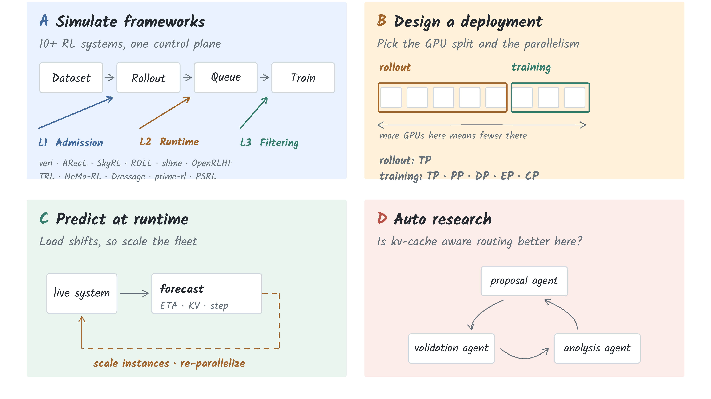

# SimRL Documentation

```{raw} html
<div class="srl-hero">
  <p class="srl-hero-eyebrow">Discrete-event simulator for asynchronous RL post-training</p>
  <h1 class="srl-hero-title">Predict what your RL job does before you run it</h1>
  <p class="srl-hero-lede">
    Profile a system, fit cost models to the records, then replay any
    configuration on CPU. Throughput, waiting time, KV occupancy, and training
    memory, without a GPU.
  </p>
</div>
```

```{raw} html
<div class="srl-hero-figure">
  
</div>
```

## Ask it a question

SimRL answers questions you would otherwise settle by running the job. Take Qwen3-8B on eight
H20s, rollout and training splitting the cluster, staleness bounded at 2. What does that system
look like when it runs, how much time is spent waiting, does training memory fit.

```{toctree}
:maxdepth: 2
:hidden:

getting-started/index
pipeline/index
reference/index
development/index
```

::::{grid} 1 2 2 4
:gutter: 3

:::{grid-item-card} Simulate a framework

More than ten typed presets, each reimplementing one real system's admission, runtime and
filtering logic. *For example: how PSRL and verl each behave on the same workload, under their own
configurations.*
:::

:::{grid-item-card} Size a deployment

GPU splits between rollout and training, instance counts, TP, PP, DP and EP. *On 32 GPUs, is
20/12 with TP2 rollout better than 16/16 with TP4?*
:::

:::{grid-item-card} Place work at runtime

Placement and finish times from a snapshot of the live system. *Rollout load spikes, so how many
engines can move to training without stalling the next batch?*
:::

:::{grid-item-card} Study a scheduler

Write a policy, replay it against the same workload as a baseline, and compare. *Does
`kv_cache_aware` routing beat `throughput_balance` on this trace?*
:::

::::

## How it works

A run is three stages, each with one job.

Profiling
: A **profiler adapter** drives a real system, vLLM, Megatron-Bridge, an FSDP2 launcher, or
  individual CUDA kernels, and normalises what it observes into versioned JSONL. Adapters never
  model anything. They record.

Cost models
: A **cost model** turns those records into a prediction, either as a `CostArtifact` with a small
  set of coefficients and the input range they are valid over, or as a direct sum over measured
  kernel tables. Models never measure anything.

Simulation
: A **discrete-event simulator** replays the rollout and training loop on one clock under a
  staleness policy, asking the cost models for latencies and peak memory as it goes.

The boundary between the first two is a documented file format. That is what lets a new backend
be added without touching the simulator, and a new cost model be fitted without re-profiling.

## Where to start

::::{grid} 1 2 2 3
:gutter: 3

:::{grid-item-card} Getting started
:link: /getting-started/index
:link-type: doc

Install, learn the vocabulary, then walk the pipeline once on Qwen3-8B. A GPU-free first
simulation is the fast path.
:::

:::{grid-item-card} The pipeline
:link: /pipeline/index
:link-type: doc

The four stages, what each one consumes and produces, and the three boundaries between them.
:::

:::{grid-item-card} Reference
:link: /reference/index
:link-type: doc

Console scripts, every configuration key, on-disk schemas, validation results, and what the code
does not do.
:::

::::
